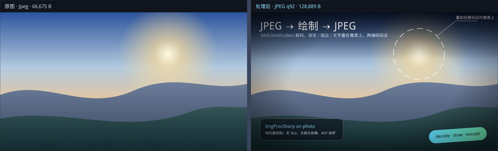

# ImgProcSharp

[](https://www.nuget.org/packages/Sevencat.ImgproSharp)
[](https://www.nuget.org/packages/Sevencat.ImgproSharp)

Drawing for [Sdcb.SimdCodecs](https://www.nuget.org/packages/Sdcb.SimdCodecs): read an image, draw shapes / gradients / strokes / TrueType text on it, write it back as PNG or JPEG. Pure managed, no native dependency, AOT-compatible.

NuGet: <https://www.nuget.org/packages/Sevencat.ImgproSharp>

```
dotnet add package Sevencat.ImgproSharp
```



<sub>`dotnet run --project samples/ImgProcSharp.Samples` 的产物，左右并排对比（`docs/compare.jpg`，由 `output/compare.jpg` 复制而来）。</sub>

```csharp
using ImgProcSharp;
using Sdcb.SimdCodecs.Abstractions;
using Sdcb.SimdCodecs.Jpeg;
using Sdcb.SimdCodecs.Png;

// 本库只依赖 Abstractions：能读写哪些格式，由你注册的编解码器决定（见「格式：自己选，自己注册」）
CodecRegistry.Register(PngImageDecoder.Registration, JpegImageDecoder.Registration);
EncoderRegistry.Register(PngImageEncoder.Registration, JpegImageEncoder.Registration);

using var image = Image.Load("in.jpg");
image.Mutate(x => x
    .Fill(new SolidBrush(new Color(0, 0, 0, 96)), new RectangularPolygon(0, 0, image.Width, 120))
    .DrawText(new TextOptions { Size = 40, Color = Color.White }, "Hello, 世界", new PointF(32, 48)));

// 图片来源信息顺带带出
Console.WriteLine($"{image.SourceFormat} {image.Width}×{image.Height}, EXIF {image.Orientation}");

// 导出：扩展名决定格式，一行写完（半透明图也不用手工摊直通缓冲，转换在编码器内部做）
image.Save("out.png");
image.Save("out.jpg", new JpegEncodeOptions { Quality = 92 });   // JPEG 没有 alpha，第 4 通道被忽略

// 要内存里的字节而不是文件时：
byte[] png = image.Encode(ImageFormat.Png);
byte[] jpg = image.Canvas.Encode(ImageFormat.Jpeg, new JpegEncodeOptions { Quality = 92 });   // 只给画布也行
```

## Status

`0.2.1` — work in progress, API 尚未稳定。

- 输入：**由你注册的解码器决定**。本库只依赖 `Sdcb.SimdCodecs.Abstractions`，引用哪个格式包、注册哪个解码器，就解哪种格式（PNG / JPEG / WebP / GIF / BMP / TIFF / QOI / Netpbm / ICO / JPEG 2000 / JBIG2 各有独立的包），包体积只算你选的。
- 输出：**一行 `Save` / `Encode`**（0.2.1 起）——本库只调 `Abstractions` 的编码契约，PNG / JPEG 的实现仍由你引用格式包并 `EncoderRegistry.Register` 登记；其余格式（WebP / TIFF / GIF 等）等 0.4（见 `plan.md` §Q）。
- 8 位 RGBA，内部预乘 alpha；不做 ICC 色彩管理（ICC 原样写回 PNG 的 `iCCP`；2.0 起任何格式的 ICC 都只扫文件头就能拿到）。
- 绘制：填充（纯色 / 线性渐变 / 径向渐变 / 图案）、描边（Miter/Bevel/Round 连接、Butt/Round/Square 端点、`MiterLimit`、虚线）、`Matrix3x2` 变换（笔刷、线宽与虚线同步跟随）、路径裁剪、TrueType 文字（掩码快路径 + 轮廓慢路径）。
- 文字：内嵌文泉驿微米黑（2 MB gzip），无 kerning / 无 GSUB / 无双向文本 / 无彩色 emoji。
- 还没做（0.4）：混合模式、图层；非等比缩放下用椭圆笔尖（现在取几何平均线宽）。差距表见 `misc.md` §I、§X、§Z、§Y。

0.2.1 相对 0.2.0：依赖从元包 `Sdcb.SimdCodecs` 收窄到 `Sdcb.SimdCodecs.Abstractions`，格式编解码器改由上层注册——`Image.Load` 之前加一行 `CodecRegistry.Register(PngImageDecoder.Registration, ...)` 即可，未注册时抛 `InvalidDataException` 并说明缺什么。**这是破坏性变更**：升级后必须显式注册，否则一张图都解不了；换来的是包里不再躺着你用不到的 WebP/TIFF/JPEG 2000。同时补上了 `Image.Save` / `Canvas.Save` / `Encode` 这组扩展方法（同样基于注册表），导出不再需要自己写 `Create`/`AddFrame`/`WriteRows`/`Commit` 样板。

0.2.0 相对 0.1.0：依赖升到 `Sdcb.SimdCodecs` 2.0.0（`Image.Load(path)` 改内存映射、任何格式的 ICC 都从文件头免费拿到），`ImageDecodeOptions.RequireIccProfile` 已失效（标 `[Obsolete]`，源码兼容），其余 API 不变。

## 现在就能用的部分（core + ext，M6/M7 完成）

```csharp
using System.Numerics;
using ImgProcSharp;

using var canvas = Canvas.Create(800, 400);
var ctx = new DrawingContext(canvas);

ctx.Clear(Color.White);
ctx.Fill(new SolidBrush(new Color(30, 30, 30, 200)), new RectangularPolygon(24, 24, 400, 96));
ctx.Fill(Color.Black, new CirclePolygon(600, 200, 80));

// 渐变 + 圆角（半径超过 min(w,h)/2 会夹成胶囊形，弧在构建期转成三次贝塞尔）
ctx.Fill(
    new LinearGradientBrush(
        new PointF(0, 0),
        new PointF(800, 0),
        new ColorStop(0f, Color.Red),
        new ColorStop(1f, Color.Blue)),
    new RoundRectanglePolygon(24, 300, 400, 60, 16));

// 描边：默认圆头端点 + 圆角连接
ctx.Draw(new Pen(Color.Yellow, 6f), new CirclePolygon(160, 200, 60));
ctx.Draw(Color.Black, 1.5f, new RoundRectanglePolygon(24, 300, 400, 60, 16));

// 描边样式：尖角 + 平头端点 / 虚线（图案长度是线宽倍数：4×6 实、4×4 虚）
ctx.Draw(
    new Pen(Color.Yellow, 4f) { LineJoin = LineJoin.Miter, LineCap = LineCap.Butt },
    new PathBuilder().MoveTo(500, 320).LineTo(600, 260).LineTo(700, 320).Build());
ctx.Draw(
    new Pen(Color.Black, 4f) { DashPattern = [6f, 4f] },
    new PathBuilder().MoveTo(500, 360).LineTo(760, 360).Build());

// 快路径：字形掩码直接当 coverage，与形状共用混合内核
ctx.DrawText("Hello, 世界", new PointF(48, 48), new TextOptions { Size = 40, Color = Color.White });

// 慢路径：字形轮廓转成 Path 后走通用填充，方便后续加变换/描边
ctx.FillText(new SolidBrush(Color.Black), "轮廓文字", new PointF(48, 150), new TextOptions { Size = 24, Align = TextAlign.Center, MaxWidth = 400 });

// 变换：不是栈，就是「当前矩阵」；PushTransform 左乘（等价 SVG 的嵌套 transform）
ctx.PushTransform(Matrix3x2.CreateTranslation(600, 120));
ctx.PushTransform(Matrix3x2.CreateRotation(-0.2f));
ctx.Fill(new SolidBrush(Color.Red), new RectangularPolygon(-60, -24, 120, 48));
ctx.ResetTransform();

// 描边文字：轮廓路径自己拿去 Draw；非恒等变换时 DrawText 也会自动走这条慢路径
Path outline = TextDrawing.GetTextPath("outline", new PointF(48, 380), new TextOptions { Size = 48 });
ctx.Draw(new Pen(Color.White, 1.5f), outline);

// 裁剪：真栈，与已有裁剪取交集；填充/描边/文字三条路径都受它约束
ctx.PushClip(new RoundRectanglePolygon(24, 300, 400, 60, 16));
ctx.Fill(new SolidBrush(new Color(255, 255, 255, 80)), new RectangularPolygon(24, 280, 400, 100));
ctx.PopClip();

SizeF measured = TextFont.BuiltIn.MeasureText("Hello, 世界", 40f);
```

变换与裁剪的语义，写在这里免得踩：

- 坐标都在用户坐标系里给，`Fill`/`Draw` 入口一次性把矩阵乘到路径上。线宽跟着缩放（`Width × sqrt(|det|)`，非等比取几何平均）；渐变/图案笔刷也跟随变换，几何（起止点、圆心、瓦片原点）都按用户坐标系理解。
- 描边样式：`LineJoin` 决定顶点外侧怎么补（`Round` 圆盘、`Bevel` 斜切、`Miter` 闭式尖角，尖角超过 `MiterLimit` 自动退回 `Bevel`）；`LineCap` 只作用于开放路径的两端；虚线图案的长度单位是**线宽倍数**，随线宽与变换一起缩放，`DashOffset` 与 SVG 的 `stroke-dashoffset` 同向。
- 变换是「当前矩阵」不是栈：`PushTransform` 只是左乘，配 `SetTransform`/`ResetTransform`。裁剪才是栈：`PushClip`/`PopClip` 必须配对，空栈 `PopClip` 会抛 `InvalidOperationException`。
- 裁剪每层是一张画布大小的 A8 掩码（1080p 约 2 MB），边界带抗锯齿；有裁剪时纯色矩形会退到通用路径。

扩展包另外提供 `Image.Load` / `Create` / `Mutate` / `Clone` / `ApplyOrientation`（net10.0）。`Mutate` 的上下文同样有 `Draw`/`PushClip`/`PushTransform`：

```csharp
image.Mutate(x => x
    .PushClip(new CirclePolygon(image.Width / 2, image.Height / 2, 200))
    .PushTransform(Matrix3x2.CreateTranslation(50, 50))
    .Draw(new Pen(Color.Red, 10f), new PathBuilder().MoveTo(0, 0).LineTo(200, 100).Build())
    .PopClip());
```

每次 `Mutate` 都是一个新的上下文：`Transform`/裁剪不会跨调用保留（`Resize` 例外——它保留变换、丢弃裁剪）。

## 示例、基准、AOT

```pwsh
dotnet run --project samples/ImgProcSharp.Samples
# → output/result.png（960×540 矢量海报：渐变背景、圆角卡片、中英文排版、裁剪条纹带、圆环描边、旋转徽章、描边文字、miter 尖角与虚线）
# → output/photo.jpg（1280×720 照片管线：JPEG 解码 → 渐变压暗 / 虚线高亮 / 信息卡 / 旋转徽章 → 编码回 JPEG）
# → output/compare.png / compare.jpg（原图与处理后左右拼一张对比图，2580×784；首页那张就是它的 JPG 版）

dotnet run -c Release --project benchmarks/ImgProcSharp.Benchmarks -- --filter "*Stroke*"
# 填充/描边/文字/编解码/端到端；ShortRunJob，十几秒出数，正式数据加 --job default

dotnet run -c Release --project samples/ImgProcSharp.AotSmoke
dotnet publish samples/ImgProcSharp.AotSmoke -c Release -r win-x64
# 两者的输出必须逐字节一致（打印确定性哈希；win-x64 自包含约 9.8 MB）
```

示例不依赖任何素材文件：海报是纯矢量拼的，照片那张现场合成后编码成 JPEG 再解码回来（放一张 `samples/assets/sample.jpg` 就会优先用它），跑完直接看图；它同时是「解码 + 裁剪 + 变换 + 描边 + 文字 + 编码」的端到端冒烟。AOT smoke 是发布形态的冒烟，基准只是「别把数量级搞错」的工具，都不进 CI 门禁。

## Layout

```
src/ImgProcSharp.Core/               绘图核心（net8.0;net10.0，不发布）
src/ImgProcSharp.SimdCodecs/         唯一打包工程（net10.0，程序集名 ImgProcSharp）
samples/ImgProcSharp.Samples/        示例控制台（net10.0，输出 result.png / photo.jpg / compare.png|jpg）
samples/ImgProcSharp.AotSmoke/       NativeAOT 冒烟（PublishAot，输出与 JIT 一致）
benchmarks/ImgProcSharp.Benchmarks/  BenchmarkDotNet 基准
tests/                               Core.Tests（net8.0;net10.0）+ SimdCodecs.Tests（net10.0）
docs/                                README 首页预览图（compare.jpg，示例产物的副本）
```

核心源码通过 `Compile Include` 编进打包程序集，因此只发一个 dll、一个包。

## 底座：Sdcb.SimdCodecs 2.0

本库只负责「画」，读和写都交给 [Sdcb.SimdCodecs](https://github.com/sdcb/SimdCodecs)。这个包值得单独夸几句——它把一个通常要靠 libjpeg / libpng / libwebp 三件套才敢接的活儿，用纯 C# 做完了：

- **纯托管，但是真 SIMD。** 名字不是噱头：JPEG 的 IDCT、YCbCr→RGBA、色度上采样，PNG 的反滤波与 RGBA8 展开，WebP 的 VP8/VP8L 重建与环路滤波，BMP/PNM 的像素搬运，全是手写的 `Vector128/256/512` 内核。于是没有 P/Invoke、没有随包发布的原生库，`PublishAot` 出来的 win-x64 自包含单文件约 9.8 MB 里就装着全套编解码器（见 `samples/ImgProcSharp.AotSmoke`：JIT 与 AOT 输出逐字节一致）。
- **一个门面，十二个格式子包。** PNG（含 APNG）、JPEG（基线 / 渐进 / 无损 / gain map）、WebP（VP8 + VP8L）、GIF、BMP、TIFF、ICO / CUR、QOI、PNM 家族（PBM / PGM / PPM / PAM / PFM）、JPEG 2000、JBIG2。格式靠 magic byte 嗅探，不看扩展名；门面 `ImageCodecs` 加元包能一行带走全部，但**子包互不依赖、也不依赖元包**——本库因此只引契约层 `Abstractions`，用哪个格式由你引子包并注册（见下一节）。
- **解码不多拷一次。** `TryDecodeInto(data, dest, stride, PixelFormat)` 让解码器直接写进调用方的缓冲（JPEG 那条路径是字面意义的零拷贝）。本库的画布就是那块缓冲——所以「解码」实际上不在本库的耗时里。
- **元数据不要钱。** `TryReadMetadata` 只扫文件头就给出 ICC / EXIF / XMP，不为了一段 ICC 去解 12 MP 的像素。本库正是靠它把「直写解码」和「读 ICC」这两件原本互斥的事同时做到（见 `plan.md` §12.2-14）。
- **文件不从托管堆过。** `ByteSource.FromFile(path)` 把文件内存映射进来，编码字节按页喂给解码器；12 MP 的 JPEG 不再需要一次 5–10 MB 的托管分配。这个类型就在 `Abstractions` 里，所以本库不引元包也照样零拷贝。
- **缩放解码是真的省算力。** JPEG 能在 DCT 域直接出 1/2…1/8 的图——出 1/8 缩略图时省掉 98% 的像素计算，而不是「先解 12 MP 再缩」。
- **编码端同样齐。** `PngWriter`（自适应滤波、`DiscardAlpha`）、`JpegEncoder`（质量、优化 Huffman、渐进），都在各自的格式包里；本库测试与示例的输出全靠它们，不必内嵌任何 dll。`DiscardAlpha` 让不透明图少一行整图拷贝、少喂 deflate 四分之一的输入，800×600 实测 184.8 → 149.7 ms。
- **保真层也没放弃。** 除了 8 位 RGBA 的 display tier，`IDecodedImage` 还保留原生位深、`ColorEncoding` 与 `ToFloats()` 的 float32 视图——16 位 PNG、HDR JPEG 这类图不会在门面里被悄悄压成 8 位。

MIT 许可，作者 [sdcb](https://github.com/sdcb)。本项目对它的全部依赖就是 `Abstractions` 的登记契约——`ImageDecoderBridge.cs`、`CodecRegistry.cs`、`EncoderRegistry.cs`、`ImageExportExtensions.cs`，一行格式实现都不抄。

## 格式：自己选，自己注册

本库只依赖契约层 `Sdcb.SimdCodecs.Abstractions`（0.16 MB：解码器/编码器注册描述、`ByteSource`、`IDecodedImage`、`PixelFormat`），**一个格式实现都不带**。用哪个格式就引哪个子包，再登记一次：

```csharp
using ImgProcSharp;
using Sdcb.SimdCodecs.Abstractions;
using Sdcb.SimdCodecs.Jpeg;
using Sdcb.SimdCodecs.Png;

// 读：按注册顺序嗅探
CodecRegistry.Register(PngImageDecoder.Registration, JpegImageDecoder.Registration);
// 写：一个格式一个编码器，同格式重复注册即替换
EncoderRegistry.Register(PngImageEncoder.Registration, JpegImageEncoder.Registration);
```

`Image.Load` / `Save` 之前调一次即可。注册是进程级、线程安全的（写时复制，编解码与注册可并发）；测试项目适合放 `[ModuleInitializer]`，控制台程序放 `Main` 第一行。

| 引的包 | 拿到什么 | dll |
|---|---|---|
| `Sdcb.SimdCodecs.Abstractions` | 本库自动带 | 0.16 MB |
| `Sdcb.SimdCodecs.Png` | PNG（含 APNG）+ `Color.Icc` | 0.34 + 0.05 MB |
| `Sdcb.SimdCodecs.Jpeg` | JPEG（基线 / 渐进 / 无损） | 0.40 MB |
| `Sdcb.SimdCodecs.Jpeg.GainMap` | Ultra HDR gain map | 0.09 MB |
| `.Webp` / `.Gif` / `.Tiff` / `.Bmp` / `.Ico` / `.Qoi` / `.Pnm` / `.Jpeg2000` / `.Jbig2` | 各自格式 | 0.06–0.65 MB |

只 PNG + JPEG ≈ 0.95 MB，全套 12 个格式 ≈ 3.1 MB。**没引的解码器不会进包**——这正是本库不在 NuGet 依赖里绑死格式的原因：`0.2.0` 依赖元包时，产物里躺着 WebP/TIFF/JPEG 2000 的解码器，哪怕你只发 PNG。

**不注册会怎样？** 解码当场失败，消息直接告诉你缺什么：

```
InvalidDataException: 没有注册任何解码器：先引用所需的格式包（如 Sdcb.SimdCodecs.Png、Sdcb.SimdCodecs.Jpeg），
再在启动时调用 CodecRegistry.Register(PngImageDecoder.Registration, JpegImageDecoder.Registration)。
```

注册了、但数据不属于任何已注册格式，则报「无法识别的图像格式」。所以「只支持 PNG」不需要额外白名单——不引 JPEG 包、不注册 JPEG 解码器就够了。

**顺序有讲究。** 先注册的先生效（嗅探顺序 = 注册顺序）。`GainMapImageDecoder` 必须排在 `JpegImageDecoder` 之前：两者都从 `FF D8 FF` 开始，前者只认真正带 HDR gain map 的 JPEG，其余的继续落到普通解码器。

**HEIF** 因 HEVC 专利不在元包的 12 个里，装 `Sdcb.SimdCodecs.Heif` 后同样一行 `CodecRegistry.Register(HeifImageDecoder.Registration)`。

**导出也是一行。** 登记编码器之后：

```csharp
image.Save("out.png");                                          // 扩展名决定格式
image.Save("out.jpg", new JpegEncodeOptions { Quality = 92 });  // 选项原样透传给编码器
byte[] bytes = image.Canvas.Encode(ImageFormat.Png);            // 只要字节，不要文件
```

画布是预乘 RGBA8，`Encode` / `Save` 直接把 `Buffer` + 自己的 stride 交给编码器（`PixelFormat.Rgba32Premultiplied`），unpremultiply 在编码器内部完成——半透明图不用先摊一张 `W*H*4` 的直通数组。实测与「`CopyToStraight` + `PngWriter.Encode`」逐字节相同；传给编码器的 stride 就是画布的 stride，行尾 padding 不会被当像素。显式格式优先于扩展名（`Save(path, ImageFormat.Png)`），扩展名不认识时抛 `NotSupportedException` 并给出写法。图片的 ICC 配置随 `ImageMetadata` 一起写回（`Image.Save` / `Encode` 自动带上，`Canvas` 版本需自己传 `metadata`）。

**没登记编码器的格式**，导出时报：

```
NotSupportedException: 没有能写 Webp 的编码器：已注册的编码器只覆盖 Png / Jpeg，
引用该格式的包后调用 EncoderRegistry.Register(...) 登记它的 Registration 即可。
```

**与元包门面等价。** 本库走的就是门面内部那套委托（`CanDecode` / `TryReadInfo` / `TryDecodeInto` / `TryReadMetadata` 与编码的 `Create` / `AddFrame` / `WriteRows` / `Commit`），实测 960×540 PNG 与 1280×720 JPEG 的像素与 `ImageCodecs.TryDecodeInto` 逐字节相同（`05351D46E4A206EA` / `83A13183B9AE4BE5`）；文件路径走 `ByteSource.FromFile` 内存映射。`CodecRegistry` / `EncoderRegistry` 也不限于官方包：任何符合 `ImageDecoderRegistration` / `ImageEncoderRegistration` 契约的实现，登记后都能用。

## Docs

- `plan.md` — 设计、里程碑、验收标准。
- `misc.md` — 决策记录、被否决的方案、依赖现状。

## License

Apache-2.0. 内嵌字体 WenQuanYi Micro Hei 为 Apache-2.0（许可见 `licenses/`）。
